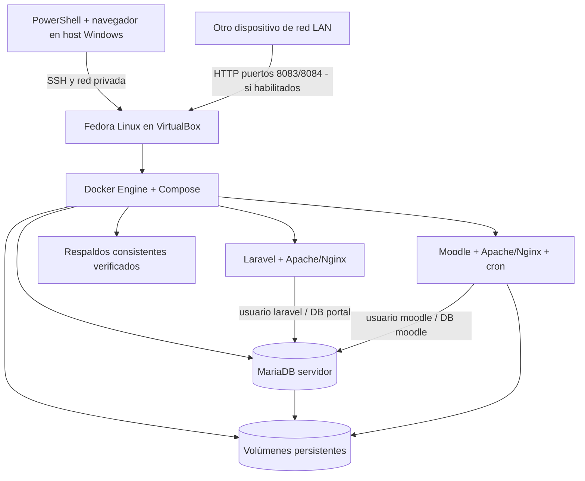

# Arquitectura propuesta (pendiente de validar en Fedora)

## Decisiones
- **VM Fedora** ya disponible, por confirmar versión real.
- **Modelo contenerizado** permitido por el enunciado; Docker obligatorio para Laravel y recomendado Compose para operar servicios conjuntamente. El manual de siete ejercicios es sólo una referencia de comandos `docker run`, **no impone la restricción sin Compose al proyecto final**.
- **Laravel** con Dockerfile propio y servidor web sirviendo únicamente `public/`. **Moodle** con la imagen/base instalable verificable y extensiones PHP apropiadas; cron definido. Seleccionar versiones de manera compatible, no asumir que una etiqueta Docker existe.
- **Bases separadas lógicamente** (`sanluquitas_moodle`, `sanluquitas_portal`) y usuarios independientes. Un único motor MariaDB puede ahorrar memoria; DB sólo en red interna Docker, sin publicación en LAN.
- **Persistencia:** al menos DB y `moodledata` y cualquier subida persistente. Mantener `config.php`, `.env` y respaldos fuera de Git.
- **Acceso LAN:** elegir modo puente de VirtualBox o configuración equivalente según red real. Evitar abrir servicios al Internet público. Ajustar firewall con criterio y probar desde otro equipo.
- **Port mapping tentativo:** Laravel `8083:80`, Moodle `8084:80` si libres. Si Moodle requiere URL/puerto externo, configurarlo explícitamente. Otras rutas mediante proxy inverso sólo si aporta simplicidad.
- **SELinux Fedora:** no deshabilitar; evitar bind mounts innecesarios, usar volúmenes Docker; al usar carpeta local, etiquetas `:Z`/`:z` según tipo de uso.
- **Backups:** dumps y archivos con prueba de restauración de al menos un registro; no confundir backup con exportar VM. En producción requeriría estrategia adicional; aquí laboratorio aislado.

## Alternativas a contrastar en matriz
Fedora vs Ubuntu/Debian; Apache vs Nginx; MariaDB vs PostgreSQL; Moodle nativo vs Docker; Docker Compose vs `docker run` individual; volúmenes vs bind mounts; backup lógico vs copia VM; puente LAN vs NAT+port-forward. Argumentar costo, administración, sostenibilidad rural, consumo, seguridad, facilidad de reproducción.

## Conectividad rural
El sistema puede funcionar en LAN cuando la conectividad externa falla **si las imágenes, dependencias y recursos requeridos están disponibles localmente**. No afirmar que Scratch alojado externamente o videos de Internet funcionan desconectados; priorizar contenidos locales.
